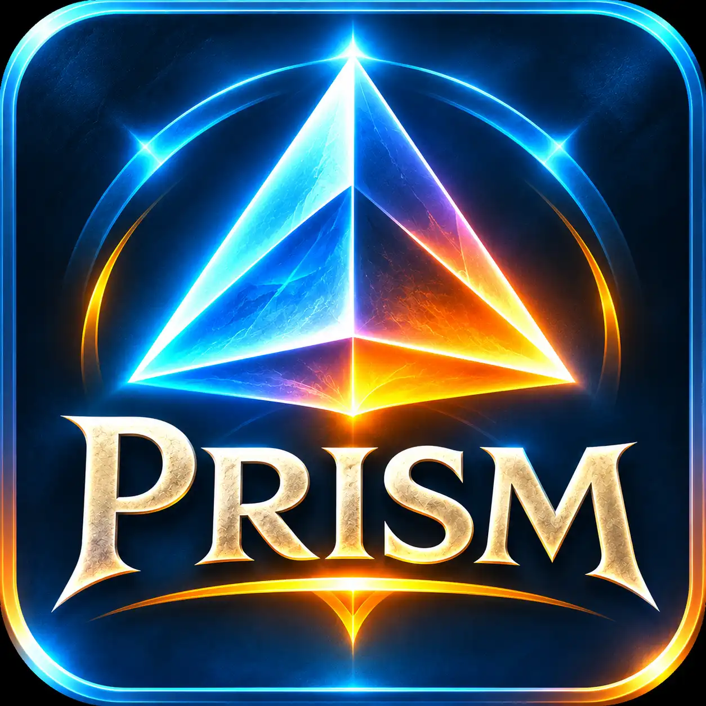
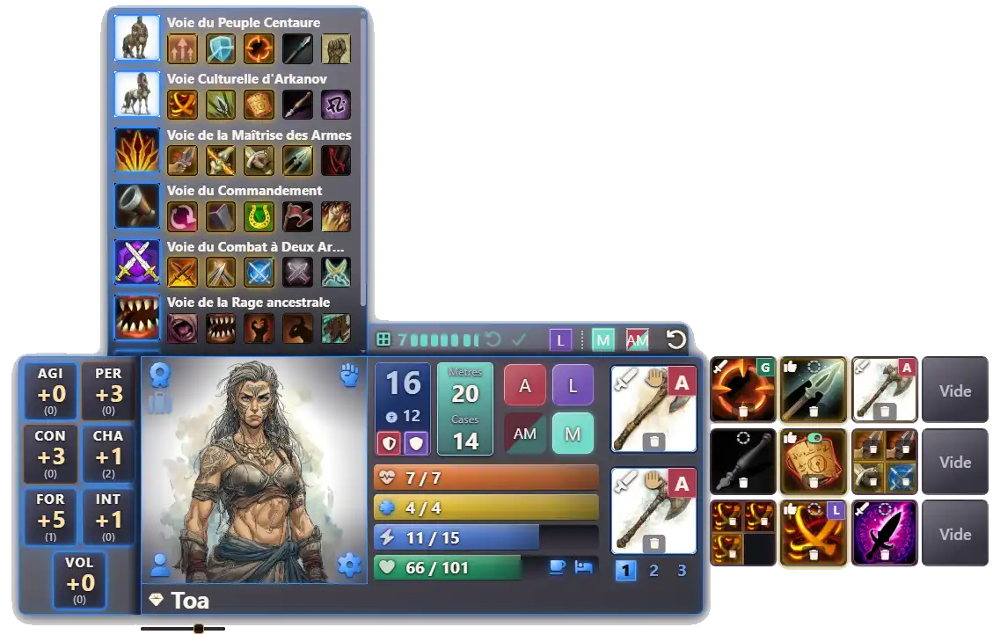

# CO2 Prism

  

**L'essentiel de votre personnage à portée de clic, directement sur la scène de Foundry VTT.**

CO2 Prism est un module pour **Chroniques Oubliées Fantasy 2ᵉ édition (CO2)** qui rassemble les informations et les actions de votre acteur dans une interface compacte et personnalisable. Consultez vos ressources, utilisez vos capacités, gérez vos équipements et vos déplacements sans ouvrir constamment votre feuille de personnage.

Depuis Prism, vous pouvez **consulter vos ressources, effectuer des tests de compétences, retrouver vos équipements et vos voies et capacités, ou utiliser des raccourcis d'action.** Les volets s'ouvrent autour du portrait pour garder les commandes à portée de main pendant la partie.

Ce module fan made a été créée par **l'Alchimiste** pour faciliter la vie des joueuses/joueurs et des meuneuses/meneurs de jeu de Chroniques Oubliées Fantasy 2ème édition sur Foundry VTT. J'espère que ça va vous plaire avec toutes les fonctionnalités proposées en complément de ce super système (gestion des actions par round, Zone Tactique et déplacements, gestion de sélections d'armes...).

J'ai voulu faire **une interface très compacte avec Prism** afin de centraliser toutes les informations nécessaires accessibles rapidement et les nouvelles fonctionnalités de jeu. Ca peut paraitre trop dense mais au moins vous n'aurez pas beaucoup l'occasion d'ouvrir votre feuille de personnage !

  

## Principales fonctionnalités

- **Informations essentielles :** portrait, caractéristiques, ressources, défenses, états et cibles.
- **Compétences :** tests directement depuis Prism.
- **Équipements, voies et capacités :** consultation et utilisation des objets et de leurs actions.
- **Raccourcis personnalisables :** actions, Items et groupes de raccourcis.
- **Gestion des mains :** trois presets d'équipement, changement de prise des armes polyvalentes et mémorisation des préférences.
- **Budget d'actions :** suivi des actions disponibles au cours du round.
- **Déplacements et Zone Tactique :** suivi des distances parcourues et visualisation des cases atteignables.
- **Interface personnalisable :** position, taille, volets indépendants et couleurs adaptées au type d'acteur.
- **Documentation intégrée :** guide utilisateur accessible depuis Foundry.

## Installation

**Compatibilité :** Foundry VTT v14 — système Chroniques Oubliées 2 (`co2`).

1. Installer le module via son manifest dans Foundry VTT, ou placer son dossier dans `Data/modules/co2prism/`.
2. Ouvrir un monde utilisant le système CO2.
3. Activer **CO2 Prism** dans la gestion des modules.

## Premiers pas

Sélectionnez un token et cliquez sur la gemme dans les contrôles de tokens pour afficher ou masquer Prism. Déverrouillez l'interface avec l'engrenage pour la déplacer, ajuster sa taille et configurer vos raccourcis. Les boutons autour du portrait permettent d'accéder aux différents volets.

La documentation intégrée détaille l'ensemble des fonctionnalités et leur configuration.

## Soutiens

Si ce travail vous plait et surtout vous aide lors de vos parties de Jeu de Rôles Chroniques Oubliées 2ème édition sur Foundry VTT, n'hésitez pas à m'offrir un p'tit café sur Ko-fi pour me motiver à créer de nouveaux outils pour les meneuses et meneurs : https://ko-fi.com/lalchimiste
Je suis ouvert à toutes les suggestions, propositions et remontées de bug sur gitHub ou directement sur Discord : l.alchimiste
